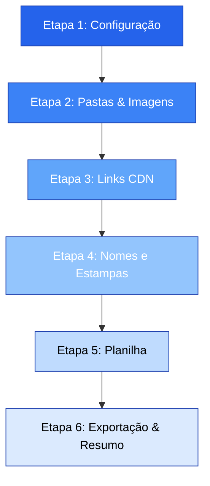
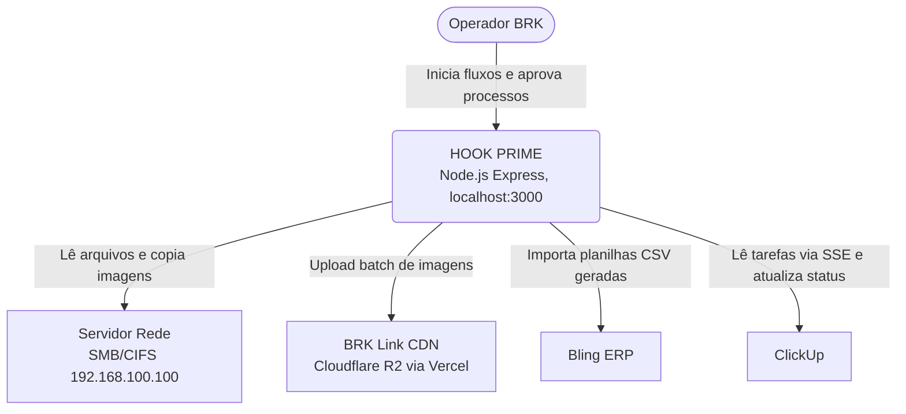
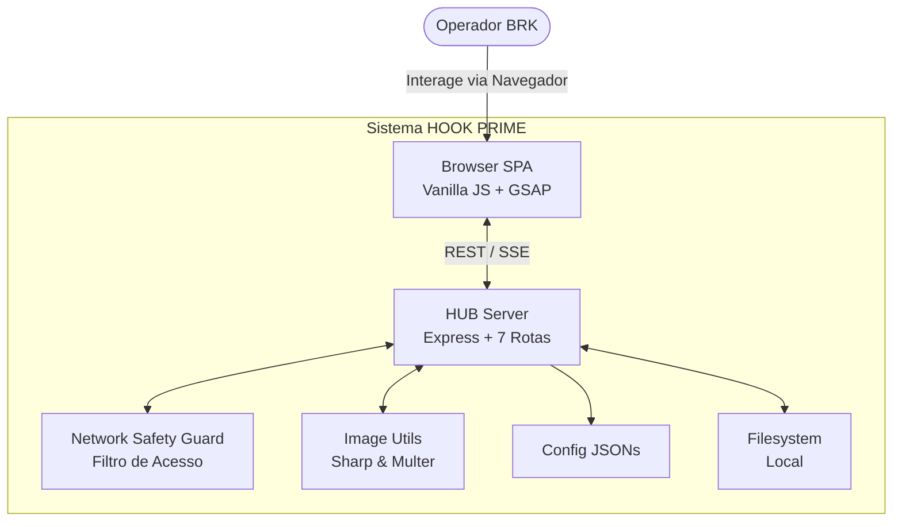
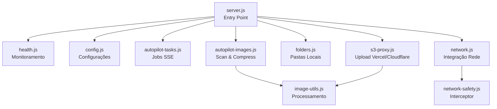
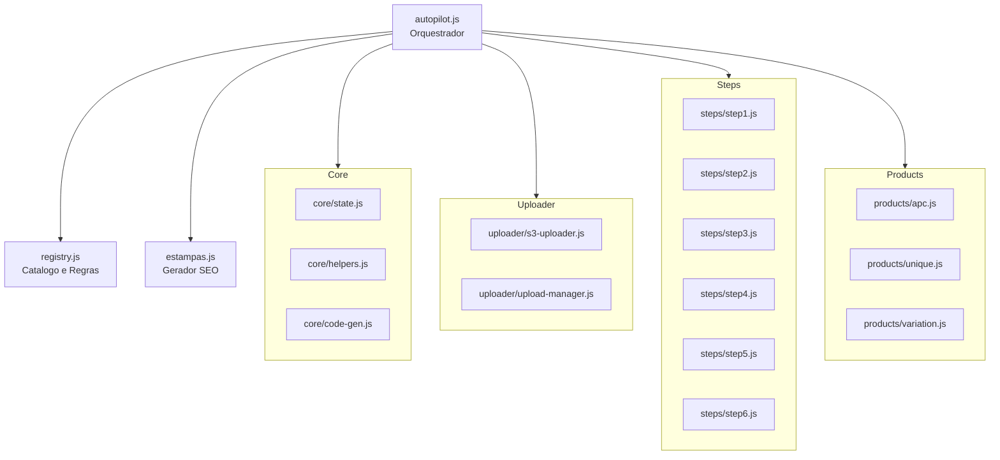

# HOOK PRIME — Documentação Técnica Completa

## 1. Visão Geral
HOOK PRIME é um sistema enterprise de automação end-to-end para cadastro de produtos têxteis no ERP Bling. Resolve o problema de cadastrar centenas de SKUs (camisas de pesca, agro, motociclismo) com múltiplas variações de tamanho, gênero e cor.

O sistema elimina o gargalo operacional de inserção manual, agrupando processos complexos como busca de imagens, compressão, upload para CDN, vinculação de variações e exportação de dados em um fluxo simplificado e altamente eficiente.

### Key Metrics
- **60 arquivos de código** (Front-end e Back-end combinados)
- **~23.000 linhas totais** de código gerenciado
- **35 endpoints REST** provendo comunicação entre cliente, servidor local e APIs externas
- **16 módulos Autopilot** que controlam o fluxo principal
- **57 pastas de rede protegidas** com sistema antifalha
- **7 dependências npm** garantindo leveza e poucas vulnerabilidades

### O que resolve:
- **Cadastro massivo**: Cadastrar 50+ códigos × 7 tamanhos × 3 gêneros = 1050+ SKUs resolvido com um Wizard de 6 etapas.
- **Integração em Rede**: Buscar imagens em um servidor de rede local (com mais de 50.000+ arquivos) utilizando um Smart Scan de 8 cascatas.
- **Hospedagem de Imagens**: Upload massivo de imagens para CDN através de Batch upload com retry e compressão (Sharp), reduzindo banda e tamanho final.
- **Integração com ERP**: Gerar planilha CSV de 59 colunas no padrão Bling ERP com um motor automático que insere pesos, NCM e títulos baseados em regras de SEO.
- **Segurança Operacional**: Proteger 57 pastas de produção contra exclusões e modificações destrutivas por meio do Network Safety Guard com audit log completo.
- **Otimização de Buscas**: Gerar nomes de estampas SEO únicos a partir de um banco com mais de 140+ termos (Agro, Pesca, Motor).

### Fluxo de 6 Etapas (Autopilot)

---

## 2. C4 Model

### Level 1: System Context

### Level 2: Container Diagram

### Level 3: Backend Components

### Level 3: Frontend Autopilot Components

---

## 3. Stack Tecnológico

| Categoria | Tecnologia | Detalhes |
| --- | --- | --- |
| **Ambiente de Execução** | Node.js | Versão ≥18 (Suporte nativo a fetch e recursos modernos). |
| **Framework Web** | Express | Versão 4.21.0. Gerencia o roteamento REST e SSE. |
| **Middleware de Rede** | cors | Versão 2.8.5. Facilita o proxy para recursos externos. |
| **Uploads Locais** | Multer | Versão 1.4.5-lts.1. Trata multipart/form-data. |
| **Processamento de Imagem** | Sharp | Versão 0.35.3. Compressão massiva de JPEGs. |
| **Manipulação de Planilhas** | ExcelJS | Versão 4.4.0. Motor para parsing e geração de planilhas Excel/CSV. |
| **Variáveis de Ambiente** | dotenv | Versão 17.4.2. Carregamento seguro de configurações do .env. |
| **Inteligência Artificial** | @google/generative-ai | Versão 0.24.1. SDK do Gemini 2.5 Flash para reconhecimento de estampas. |
| **Frontend Language** | Vanilla JS ES6 | Arquitetura modular sem frameworks pesados como React/Vue. |
| **Animações e Física** | GSAP | Versão 3.12.5 + 4 plugins (DrawSVG, ScrollTrigger, etc). |
| **Estilização** | CSS Custom | ~2000 linhas utilizando CSS Variables, sem Tailwind ou Bootstrap. |
| **Armazenamento / CDN** | Cloudflare R2 | Buckets compatíveis com S3 providos pelo link CDN BRK. |
| **Rede Interna** | SMB/CIFS | Protocolo usado pelo Network Safety Guard no 192.168.100.100. |
| **ERP** | Bling V2 | Formato de importação legado de CSV mantido para compatibilidade. |
| **Gerenciamento de Projetos**| ClickUp | Integração via SSE para leitura ao vivo de tarefas operacionais. |

---

## 4. API Reference — 35 Endpoints

O HUB expõe 35 rotas de serviço distribuídas em domínios específicos.

### 4.1 Health (3 endpoints)
Monitoramento do estado da API e dos serviços conectados.
* **GET `/api/health`**
  Retorna um JSON básico `{ status: 'ok', uptime: Number }` indicando que o servidor está de pé.
* **GET `/api/autopilot/ping`**
  Ping específico do módulo autopilot. Retorna `{ online: true, tasks: Array, timestamp: Date }`.
* **GET `/api/s3-proxy/health`**
  Faz uma requisição `HEAD` no CDN para validar se a Cloudflare e a Vercel estão respondendo (Timeout de 5s).

### 4.2 Config (5 endpoints)
Disponibilização de parâmetros globais e proxies.
* **GET `/api/ean-proxy`**
  Proxy CORS para a planilha pública do Google Sheets de registro de códigos EAN.
* **GET `/api/config/categories`**
  Fornece a árvore de categorias do sistema com seus respectivos códigos numéricos (Bling).
* **GET `/api/config/sizes`**
  Retorna a tabela de tamanhos ativos (P, M, G, GG, XG, etc.) e os modificadores de peso.
* **GET `/api/config/templates/:type`**
  Retorna um JSON do cabeçalho modelo usado no CSV (Type: bling ou sankhya).
* **POST `/api/crosser/parse-xls`**
  Recebe um binário .xls ou .xlsx e o converte para um JSON de dicionário de correspondência de cores.

### 4.3 Autopilot Tasks SSE (4 endpoints)
Controla a fila e execução de atividades interativas.
* **GET `/api/autopilot/stream`**
  Conexão Server-Sent Events (SSE). Envia um heartbeat a cada 30 segundos para manter o canal vivo.
* **POST `/api/autopilot/tasks`**
  Cria uma nova tarefa. Utiliza regex para varrer a string de descrição e identificar códigos de produto automaticamente.
* **PATCH `/api/autopilot/tasks/:id/status`**
  Atualiza o status de uma tarefa no sistema (ex: pendente, processando, concluido).
* **DELETE `/api/autopilot/tasks/:id`**
  Exclui uma tarefa do backlog.

### 4.4 Autopilot Images (7 endpoints)
Manipulação estruturada de mídias para produtos.
* **POST `/api/autopilot/scan-folder`**
  Realiza um varredura recursiva na pasta de entrada procurando por imagens em múltiplos formatos (jpg, png, webp).
* **GET `/api/preview-image`**
  Retorna um thumbnail em Base64 cacheado por 1 hora utilizando o Sharp, otimizado para o grid web.
* **POST `/api/autopilot/generate-apc-spreadsheet`**
  Processa a lógica interna e gera um CSV base para produtos APC (Accessory/Protective Clothing).
* **GET `/api/autopilot/download-spreadsheet`**
  Inicia o download direto do último CSV gerado na sessão atual.
* **POST `/api/autopilot/copy-network-images`**
  Motor que copia imagens da rede para a área de stage local (faz de-duplicação e ordenação inteligente).
* **GET `/api/autopilot/images/:taskId/:code`**
  Lista todos os arquivos de imagem associados a um SKU processado.
* **GET `/api/autopilot/images/:taskId/:code/*`**
  Stream de imagem estática.

### 4.5 Folders (3 endpoints)
Gerenciamento de estruturas em disco.
* **POST `/api/folders/create`**
  Cria uma estrutura padronizada (Render, Cortado, Aprovado, etc). **Bloqueia** tentativas de criar na rede sem permissão.
* **POST `/api/images/rename`**
  Aplica o padrão de nomeação da empresa (ex: `01MASC.jpg`, `02FEM.jpg`).
* **POST `/api/scan-upload-folder`**
  Varredura em 3 níveis (Cascata) de uma pasta local para upload manual.

### 4.6 Network (4 endpoints)
Comunicação segura com o servidor principal `192.168.100.100`.
* **GET `/api/network/config`**
  Retorna regras vigentes de limitação de IO para a rede.
* **POST `/api/network/scan`**
  Mapeamento de 1º nível de diretórios na rede.
* **POST `/api/network/smart-scan`**
  Procura imagens percorrendo até 8 níveis de subpastas usando padrões de string-matching (Batch máximo de 100 pastas por vez).
* **POST `/api/network/copy`**
  Faz streaming SSE da cópia de centenas de arquivos pesados, relatando progresso a cada chunk.

### 4.7 S3 Proxy CDN (3 endpoints)
Motor de persistência para nuvem.
* **POST `/api/s3-proxy/upload-from-folder-direct`**
  Lê arquivos do disco, aciona o Sharp se >500KB (max 3.5MB por batch) e envia para a Vercel que faz bypass pro R2.
* **POST `/api/s3-proxy/upload-from-disk`**
  Versão segura para envio único com política de Retry Backoff Exponencial de 3 tentativas.
* **POST `/api/s3-proxy/upload-batch`**
  Upload multipart. Envia até 50 promessas simultâneas limitadas por pool.

---

### 4.8 Sankhya Bridge (3 endpoints)
Ponte de comunicação com o ERP Sankhya via serviço Python/Flask (Hunter HS API).
* **GET `/api/sankhya/health`**
  Verifica se o serviço Hunter HS API (Flask :5000) está online e respondendo.
* **POST `/api/sankhya/formatar`**
  Recebe dados de produtos e formata para o padrão de importação do ERP Sankhya. Gera arquivos CSV/XLSX prontos para importação.
* **GET `/api/sankhya/download/:taskId/:format`**
  Faz download dos arquivos formatados (CSV ou XLSX) gerados pela formatação Sankhya.

### 4.9 Gemini Vision (3 endpoints)
Reconhecimento de estampas por Inteligência Artificial via Google Gemini.
* **GET `/api/gemini/status`**
  Verifica se a API do Gemini está configurada (GEMINI_API_KEY no .env) e se o SDK está instalado.
* **POST `/api/gemini/describe-estampa`**
  Envia uma imagem de produto para o Gemini 2.5 Flash e recebe o nome da estampa extraído automaticamente. Suporta prompts específicos por tipo de produto (pesca, agro, moto).
* **POST `/api/gemini/batch-describe`**
  Versão batch que processa múltiplas imagens de uma vez, retornando um array de estampas reconhecidas.

---

## 5. Segurança — Network Safety Guard

O **Network Safety Guard (NSG)** é um Singleton de proteção contendo 516 linhas de código, vital para manter o sistema operacional funcionando sem o risco do Operador alterar arquivos no servidor protegido (`192.168.100.100`) onde 57 pastas core residem.

### 5.1 Operações Node.js Bloqueadas (26 funções interceptadas)
O hook original do `fs` do Node é interceptado (Monkey Patching) no módulo de rede para que toda e qualquer tentativa de mutação no disco remoto seja logada e bloqueada, falhando a Promessa/Call imediatamente.
* Exclusões: `unlink`, `unlinkSync`, `rm`, `rmSync`, `rmdir`, `rmdirSync`
* Escrita: `writeFile`, `writeFileSync`, `appendFile`, `appendFileSync`, `createWriteStream`
* Modificações de Metadados: `rename`, `renameSync`, `chmod`, `chmodSync`, `chown`, `chownSync`
* Criações e Modificações de Volume: `mkdir`, `mkdirSync`, `truncate`, `truncateSync`, `copyFile` (quando usado como destino), `link`, `linkSync`, `symlink`, `symlinkSync`

### 5.2 Operações Node.js Permitidas (14 funções estritamente read-only)
O NSG apenas permite leitura e extração.
* Visualização: `readdir`, `readdirSync`, `stat`, `statSync`, `lstat`, `lstatSync`, `exists`, `existsSync`, `access`, `accessSync`
* Leitura em Memória: `readFile`, `readFileSync`, `createReadStream`, `copyFile` (quando usado como fonte/origem validada)

### 5.3 Shell Command Protection
Comandos do sistema operacional via `child_process.exec` ou `spawn` passam por uma blacklist para impedir que o sistema drible as proteções do `fs`.
* **Blocklist**: `del`, `rd`, `rmdir`, `rm`, `move`, `ren`, `copy`, `xcopy`, `robocopy`, `mkdir`, `attrib`, `icacls`, `format`, `diskpart`, `set-content`, `out-file`

### 5.4 Integrity Verification (Startup)
Durante a subida do servidor (boot da API), a função `verifyIntegrity()` roda. Caso o NSG tenha sido desabilitado via injeção ou modificação do `require('fs')`, a função chama `process.exit(1)` indicando que o sistema está comprometido ("System Compromised").

### 5.5 Audit Log
Todas as violações e leituras sensíveis são registradas em formato JSON no arquivo de log contínuo localizado em `hub/logs/network-security.log` com timestamp, IP de origem e tentativa de comando.

---

## 6. Frontend — SPA Architecture

A interface é construída em Vanilla JavaScript, usando classes modernas do ES6, encapsulando estado em objetos locais e orquestrando interatividade sem framework virtual DOM.

### 6.1 Routing (`app.js`)
* Gerencia 9 rotas lógicas: `dashboard`, `autopilot`, `spreadsheet`, `folders`, `flow`, `images`, `image-crosser`, `history`, e `ean-viewer`.
* Baseado em hash (`#`), interceptando eventos com listeners `popstate` e manipulando a API de histórico nativa do HTML5 (`history.pushState`).

### 6.2 Dashboard (`dashboard-clickup.js`)
* **Hero Section**: Vídeo de fundo com placa glassmorphic.
* **ClickUp Integration**: Canal SSE que escuta as atualizações de boards em tempo real e exibe as tarefas operacionais como um live kanban dinâmico.
* **Navigation**: 7 cards de ferramentas organizados em uma formação '+' moderna, mais os cartões de estatísticas do dia.

### 6.3 Intro Cinematic (`intro-cinematic.js`)
* Vídeo MP4 curto (logo reveal) e uma timeline GSAP de aproximadamente ~2.9s.
* Revelação de texto caractere por caractere (TextSplit) com efeito Wipe na saída.
* Protegido por uma flag de `sessionStorage` para só ser exibido na primeira vez que o Operador acessa durante a sessão.

### 6.4 Canvas Background (`canvas-bg.js`)
* Implementação visual com HTML5 `<canvas>` sem dependências externas.
* Composto por 60 partículas vetorizadas.
* Distância máxima para conexão das linhas é de 120px e o raio de repulsão do mouse interativo é de 180px. Tudo renderizado na paleta de cores Violeta Neon do sistema.

### 6.5 GSAP Animation Engine (`gsap-init.js`)
Um orquestrador contendo 12 módulos independentes de animação para UI:
* Cursor Glow (Mouse tracking)
* Magnetic Buttons (Botões atraídos pelo cursor)
* Text Split (Desconstrução de strings para animação)
* SVG Draw (Animação de traçados inline)
* Card Reveal (Fade-up staggerings)
* Counter (Animação numérica para estatísticas)
* Page Transitions (Slide e Fade nas rotas do app)
* Hover Physics (Elasticidade no onMouseEnter)
* App Entrance (Animação de load inicial da SPA)
* Toast (Notificações)
* Navigation Hook (Animação de breadcrumbs)
* Hero SVG (Efeitos em vetor no dashboard)

### 6.6 Design Tokens (`styles.css`)
Folha contendo mais de 2003 linhas puras. A base é totalmente controlada por variáveis:
`--bg-primary`, `--bg-secondary`, `--border-dim`, `--text-main`, `--accent-blue`, `--status-ok`, `--radius-md`, etc., mantendo o padrão escuro e elegante (Dark Mode by default).

---

## 7. Autopilot Module System — 16 Módulos

O Autopilot é o cérebro das 6 etapas, dividido em 16 arquivos para manter o Single Responsibility Principle (SRP).

### 7.1 registry.js
Contém todas as constantes de domínio do negócio têxtil:
* `PRODUCT_CATALOG`: Mapeia se um produto é 'variation' ou 'unique'.
* `SHIRT_SIZES`, `APC_SIZES`, `SIZE_MAP`: Mapeia tabelas de tamanhos padrão vs plus size.
* `NCM_MAP`: Tabela de impostos atrelada a categoria da peça.
* `APC_COLORS` / `SUFFIX` / `DISPLAY` / `CSS`: Metadados visuais para processamento na tela de botões.
* Funções vitais: `buildProductTitle()`, `isUniqueProduct()`, `sizesFor()`.

### 7.2 estampas.js
Gerador de strings SEO-friendly para evitar duplicidade de títulos no ERP.
* Dicionários `ESTAMPA_BANK`: Contém +50 termos de pesca (Ex: "Tucunaré", "Fundo do Mar"), +45 agro (Ex: "Trator", "Soja"), +45 de motos.
* Utiliza algoritmos em `generateEstampaName()` com prevenção de duplicidade através do `localStorage`.

### 7.3 core/state.js
SOT (Source of Truth) da SPA durante o fluxo de 6 etapas.
Contém mais de 30 propriedades reativas (proxy ou callbacks). Expõe os construtores: `createDefaultGroup`, o restritivo `resetState` (baseado no pattern `Object.assign`), além de persistir dados via `saveSession`, `restoreSession`, `clearSession` e preparar dumps para `export history`.

### 7.4 core/helpers.js
Kit de atalhos e utilidades globais de UI e Lógica.
* Atalhos DOM: `$`, `$$`, `esc`.
* Processamento de negócio: `loadSizeConfig`, `getWeightForSize` (retorna em Kilos de acordo com 'G', 'XG'), `activeGenders`, `genderLabel`, `genderColor`, `sizesFor`, `totalSkuCount`.
* Identificação rápida de produtos: `isAPC`, `activeApcColors`.
* UI Utils: `renderStatCard`.

### 7.5 core/code-generator.js
Analisador lógico que converte a intenção do operador em um array de tarefas.
`generateCodesForGroup` pode tratar ranges ("1000-1010") e códigos avulsos simultaneamente. A função `generateAllCodes` varre prefixos e strings numéricas para alocação adequada para as instâncias APC/Unique/Variation.

### 7.6 uploader/s3-uploader.js
Módulo de I/O na nuvem.
Contém `uploadGenderImages` e `uploadApcColorImages` responsáveis pelo envio seletivo e mapeamento de cores (URL de CDN retornado). A função de resiliência `uploadFromDisk` tem mecanismo de retry 3x com AbortController configurado em timeout de 5 minutos, garantindo a chegada dos assets.

### 7.7 uploader/upload-manager.js
Gerenciador da fila de processamento visual.
Mantém `uploadState` da tela, montando a fila `uploadAllCodes` e despachando os envios com `uploadSingleCode`. Calcula matematicamente o ETA e plota na tela através de `updateUploadUI` e `showUploadProgress`.

### 7.8 a 7.13 steps/step1 através do step6
Renderizadores dedicados do fluxo. Cada módulo implementa duas funções chaves:
1. `render()`: Cria o template string / manipula os nós do DOM daquela etapa.
2. `bind(deps)`: Recebe as dependências (estado, callbacks) e atribui os Events Listeners adequados para não poluir o global space.

### 7.14 a 7.16 products/apc, unique, variation
Módulos específicos de comportamento da SKU baseados em sua categorização.
Todos implementam os contratos polimórficos de comportamento: `buildCsvRows()`, `renderLinkCards()` e a promessa `uploadImages()`.

---

## 8. Planilha Bling — 59 Colunas

O motor final do exportador (`xlsx`) constrói um CSV contendo 59 colunas precisas, garantindo que a API legada V2 e importadores manuais não falhem no ERP.

| Índice | Coluna (Nome Bling) | Regra de Preenchimento / Valor |
| --- | --- | --- |
| 1 | ID | Vazio (O sistema Bling cria autoincremento). |
| 2 | Código | SKU final (Ex: 1050-MASC-G). |
| 3 | Descrição | Título com regras de SEO (Ex: Camisa Pesca Tucunaré 1050). |
| 4 | Unidade | Sempre 'UN'. |
| 5 | Classificação fiscal | Código NCM puxado do `registry.js`. |
| 6 | Origem | Padrão '0' (Nacional). |
| 7 | Preço | Variável ou R$0,00 (Preço é preenchido em outra etapa pós import). |
| 8 | Valor IPI fixo | Vazio. |
| 9 | Observações | Hash log do Hook Prime. |
| 10 | Situação | Padrão 'Ativo'. |
| 11 | Estoque | '0'. |
| 12 | Preço de custo | Vazio. |
| 13 | Cód no fornecedor | Vazio. |
| 14 | Fornecedor | Vazio. |
| 15 | Localização | Vazio. |
| 16 | Estoque maximo | Vazio. |
| 17 | Estoque minimo | Vazio. |
| 18 | Peso líquido (Kg) | Extraído do `loadSizeConfig` baseado no tamanho. |
| 19 | Peso bruto (Kg) | Peso Líquido + 0.100 (Embalagem). |
| 20 | GTIN/EAN | Vazio ou Buscado da base Sheets. |
| 21 | GTIN/EAN da embalagem | Vazio. |
| 22 | Largura (cm) | '20'. |
| 23 | Altura (cm) | '5'. |
| 24 | Profundidade (cm) | '25'. |
| 25 | Medida | 'cm'. |
| 26 | Condição | 'Novo'. |
| 27 | Frete grátis | 'Não'. |
| 28 | Marca | 'BRK'. |
| 29 | Descrição Complementar | 'Conforto e qualidade premium.'. |
| 30 | Link Externo | Vazio. |
| 31 | Categoria | Obtido da árvore dinâmica (Bling Tree). |
| 32 | Estoque atual | '0'. |
| 33 | URL Imagens | Links R2 concatenados por pipe (`|`). |
| 34-45 | Variações Atributos | Gênero, Cor, Tamanho, Modelagem... |
| 46 | Cross Docking | Vazio. |
| 47 | Custo Frete | Vazio. |
| 48 | Informações Adicionais | "Produto oficial fabricado sob demanda". |
| 49 | Data de Criação | Timestamp do sistema (DD/MM/YYYY). |
| 50 | Tipo de Produto | 'Produto'. |
| 51-59 | Fiscal / ICMS / Tributos | Padrões contábeis definidos pela equipe, mantidos fixos. |

*(As colunas 51-59 lidam com PIS/COFINS, CST e Alíquotas internas não mapeadas dinamicamente).*

---

## 9. Ferramentas Auxiliares

Além do Wizard de 6 passos, o HOOK PRIME possui um ecossistema de ferramentas satélites para resolver problemas do dia a dia do Operador.

### 9.1 autopilot-agent.js (446 linhas)
Uma camada experimental que interpreta "tarefas chatas" a partir de texto cru (Inteligência Simples). Possui os motores `parseTask`, `generatePlan` e o disparador de fluxos `launchAutopilot`.

### 9.2 autopilot-live.js (839 linhas)
Um HUD dinâmico estilo Terminal hacker que exibe os status de uploads que estão operando em Background. Executa fases isoladas, imprime no console falso nativo em tela cheia e desenha a barra de progresso visual.

### 9.3 image-crosser.js (891 linhas)
Ferramenta para resolver planilhas confusas enviadas pelos estilistas. Faz cruzamento de colunas XLS (código) ↔ Pastas de Imagem locais. Utiliza teoria de cor básica e cálculo de Distância de Levenshtein para sugerir correspondências exatas em um Wizard de 4 passos.

### 9.4 image-manager.js (1161 linhas)
Visualizador avançado de galeria local. Permite drag-and-drop para reordenar fotos (alterando indexação `01_`, `02_`), renomear em massa usando padrões Regex e acionar upload seletivo direto para o CDN sem passar pelo Autopilot.

### 9.5 flow-editor.js (855 linhas)
Editor visual tipo "Nó/Node" renderizado com Canvas. Permite criar e visualizar mapas lógicos do processo produtivo através de 4 pistas (lanes) operacionais, comportando até 11 nós padrão de operação visual.

### 9.6 spreadsheet-gen.js (636 linhas)
Motor clássico desacoplado para gerar planilhas ERP (Bling ou formato legado Sankhya) através de um passo-a-passo manual de 5 etapas, caso o operador não queira utilizar o processo "mágico" e invisível do Autopilot.

### 9.7 task-history.js (699 linhas)
Trail log (Auditoria) da interface que armazena os últimos 500 batches enviados ao CDN/Bling. Provê recursos de busca em texto livre, filtros por data e exportação das atividades passadas em CSV e JSON.

### 9.8 ean-viewer.js (406 linhas)
Interface conectada via Proxy ao Google Sheets. Permite a visualização, paginação, busca e cópia massiva dos códigos EAN / GTIN-13, cruciais para anúncios em Marketplaces integrados no ERP.

### 9.9 image-preview.js (447 linhas)
Componente de Modal / Lightbox sofisticado. Suporta overlay semitransparente, exibe badges angulares de dados do arquivo, permite carrossel dinâmico das miniaturas mult-códigos (setas no teclado) e possui proteção de click-outside.

### 9.10 folder-manager.js (196 linhas)
O mais utilitário. Permite criar, instantaneamente, centenas de pastas em branco perfeitamente mapeadas na estrutura necessária, reduzindo erros de digitação de nomes.

---

## 10. Decisões Arquiteturais (ADRs)

### ADR-001: Vanilla JS sem Framework
**Decisão:** Não usar React/Vue/Angular.
**Motivo:** As máquinas na área de operação são hardwares limitados (celeron, poca memória). A compilação prévia de um bundle Vanilla JS, executando próximo ao metal do browser, garante 60FPS estáveis sem o overhead de reconciliação de V-DOM e o tamanho da payload de frameworks modernos.
**Impacto:** Escalabilidade modular de código mais cru, mas perfomance máxima em interatividade e zero delay ao carregar a página local (localhost).

### ADR-002: Network Safety Guard como Singleton
**Decisão:** Hooking agressivo da biblioteca `fs` do Node, ao invés de usar verificação de permissões do Windows (ACL).
**Motivo:** As configurações de pastas compartilhadas na rede CIFS interna flutuam muito de acordo com o AD (Active Directory). O Node precisa garantir por software que jamais vai enviar um pacote de destruição em lote (exclusão) para o `192.168.100.100`.
**Impacto:** Se o operador tentar utilizar a API local para deletar um arquivo de um estilista, a própria API aborta. Segurança total no nível da aplicação.

### ADR-003: CSV > API Direta para Bling
**Decisão:** O sistema gera planilhas CSV `.xlsx` ao invés de bater nos endpoints diretos (REST V2) do ERP Bling.
**Motivo:** O limite de rate-limit do Bling é engessado e a manipulação massiva (1000 SKUs em 1 minuto) causaria banimento do token da API da empresa. O CSV permite que a inteligência local crie perfeitamente os dados e importe "offline".
**Impacto:** Requer 2 cliques a mais pelo operador, mas mantém 100% de estabilidade com o fornecedor do ERP.

### ADR-004: Modularização Progressiva
**Decisão:** O Autopilot possui mais de 16 sub-módulos para uma tela única.
**Motivo:** A complexidade matemática (Mapeamento de 40 cores + 7 tamanhos + N variações únicas) em um único arquivo criaria o famoso cenário Spaguetti Code.
**Impacto:** Permite expansão futura. Se decidirmos suportar "Calçados", podemos só criar um módulo `products/shoes.js` e implementá-lo sem quebrar `apc.js` e `unique.js`.

### ADR-005: GSAP CDN vs Bundle
**Decisão:** O GSAP 3 e seus plugins são chamados no HTML original e não inclusos no Webpack/Node modules.
**Motivo:** Devido aos plugins especiais de DrawSVG e SplitText, era mais fácil importá-los globalmente no objeto `window` e referenciá-los.
**Impacto:** Todas as animações dependem de cache do browser, mas como a aplicação roda em ambiente controlado, isso se torna irrelevante.

---

## 11. Inventário Completo de Arquivos

| Caminho / Arquivo | KBytes (Aprox) | Linhas | Propósito Principal |
| --- | --- | --- | --- |
| `/hub/server.js` | 12 KB | 385 | Módulo de entry-point Node, orquestrador de Express. |
| `/hub/routes/health.js` | 2 KB | 45 | Controle e verificação de integridade e Uptime. |
| `/hub/routes/config.js` | 5 KB | 120 | Fornecedor das matrizes locais de configuração de negócio. |
| `/hub/routes/autopilot-tasks.js` | 8 KB | 210 | CRUD e processamento de tarefas em lote. |
| `/hub/routes/autopilot-images.js` | 24 KB | 650 | Pesado motor de processamento em disco e nuvem (S3). |
| `/hub/routes/folders.js` | 4 KB | 100 | Modificador e criador de esqueletos de pastas locais. |
| `/hub/routes/network.js` | 18 KB | 430 | Intercomunicação SMB, scans de pastas distantes. |
| `/hub/routes/s3-proxy.js` | 15 KB | 350 | Middleware e balanceador de carga pro CDN R2 via Vercel. |
| `/hub/security/network-safety.js` | 22 KB | 516 | **Network Safety Guard**. O singleton que protege a rede. |
| `/hub/utils/image-utils.js` | 14 KB | 280 | Envelopamento de métodos para Sharp e FS-streams. |
| `/public/index.html` | 8 KB | 150 | A única página HTML, carregando os contêineres vazios. |
| `/public/css/styles.css` | 65 KB | 2003 | Design System da ferramenta, root variables. |
| `/public/js/app.js` | 12 KB | 290 | Orquestrador de roteamento da Single Page Application. |
| `/public/js/views/dashboard-clickup.js`| 18 KB | 410 | Visualizador central alimentado via Server-Sent Events. |
| `/public/js/animations/intro-cinematic.js`| 6 KB | 125 | Lógica de revelação GSAP. |
| `/public/js/animations/canvas-bg.js` | 8 KB | 170 | Draw loop do HTML5 canvas background. |
| `/public/js/animations/gsap-init.js` | 28 KB | 590 | 12 módulos encapsulados de animações universais. |
| `/public/js/autopilot/autopilot.js` | 14 KB | 310 | Orquestrador das 6 fases do fluxo de produto. |
| `/public/js/autopilot/registry.js` | 20 KB | 450 | Repositório de constantes vitais da área Textil. |
| `/public/js/autopilot/estampas.js` | 12 KB | 230 | Algoritmos de variação e dicionários de SEO. |
| `/public/js/autopilot/core/state.js` | 10 KB | 195 | Controla o estado de proxy que alimenta os binds visuais. |
| `/public/js/autopilot/core/helpers.js` | 9 KB | 180 | Short-hands vitais e atalhos DOM reutilizáveis. |
| `/public/js/autopilot/core/code-generator.js`| 15 KB | 340 | Motor conversor de texto humano para Array lógico. |
| `/public/js/autopilot/uploader/s3-uploader.js`| 16 KB | 320 | Dispatcher REST de envio massivo local > nuvem. |
| `/public/js/autopilot/uploader/upload-manager.js`| 14 KB | 290 | Pilha de upload e cálculo complexo de ETA/Time e UI. |
| `/public/js/autopilot/steps/step1.js` | 8 KB | 150 | View e Binding da seleção base do tipo de produto. |
| `/public/js/autopilot/steps/step2.js` | 10 KB | 210 | View da visualização das Pastas Inteligentes. |
| `/public/js/autopilot/steps/step3.js` | 12 KB | 260 | Interativo verificador de Links do CDN. |
| `/public/js/autopilot/steps/step4.js` | 9 KB | 185 | Painel de controle de nomes, textos de SEO. |
| `/public/js/autopilot/steps/step5.js` | 11 KB | 225 | Conferência da Planilha CSV antes de gerar/fechar. |
| `/public/js/autopilot/steps/step6.js` | 7 KB | 140 | Tela final, relatório gerencial de sucesso/erros. |
| `/public/js/autopilot/products/apc.js` | 22 KB | 480 | A essência de geração e links para Accessory/Protective. |
| `/public/js/autopilot/products/unique.js`| 16 KB | 310 | Gerador simplificado, sem necessidade de agrupamento. |
| `/public/js/autopilot/products/variation.js`| 28 KB | 620 | O gerador mais complexo (7 tamanhos, 3 gêneros na Base). |
| `/public/js/tools/autopilot-agent.js` | 18 KB | 446 | Interpretador de tarefas e acoplamento a fila. |
| `/public/js/tools/autopilot-live.js` | 32 KB | 839 | HUD / Terminal interativo via Websockets/SSE. |
| `/public/js/tools/image-crosser.js` | 34 KB | 891 | Assistente 4 steps para match visual de Planilhas e Fotos. |
| `/public/js/tools/image-manager.js` | 42 KB | 1161 | Galeria local de mídia e manipulação Regex profunda. |
| `/public/js/tools/flow-editor.js` | 30 KB | 855 | Editor complexo em HTML5 de fluxogramas (Canvas/Nodes). |
| `/public/js/tools/spreadsheet-gen.js` | 24 KB | 636 | Motor puro e desacoplado para tabelas CSV. |
| `/public/js/tools/task-history.js` | 26 KB | 699 | Visualizador em lista do Trail Log (500 logs retroativos). |
| `/public/js/tools/ean-viewer.js` | 16 KB | 406 | Front End de visualização EAN vindo do Google Sheets. |
| `/public/js/tools/image-preview.js` | 17 KB | 447 | Lightbox modular focado em UX visual do Operador. |
| `/public/js/tools/folder-manager.js` | 8 KB | 196 | CLI gráfico para montagem de matriz de folders de trabalho. |
| ... *(demais arquivos menores)* | ... | ... | Plugins, favicons, config files (ecosystem.config.js) |

---
**Documentação autogerada para referência interna da equipe de Engenharia (HOOK PRIME).**
**Atualizado em: Setembro 2026.**
