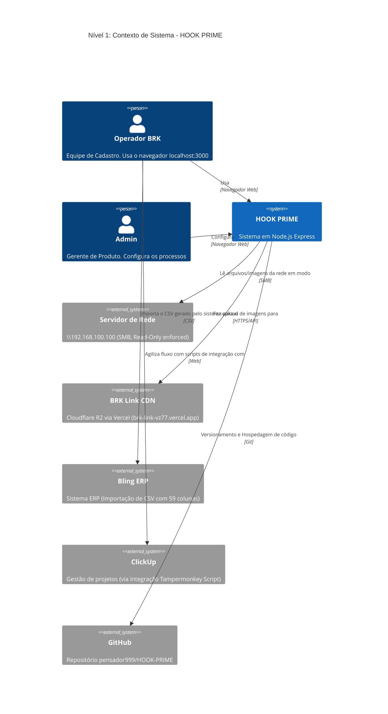
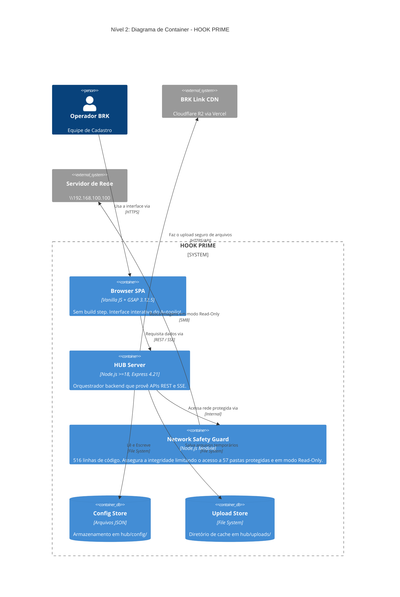
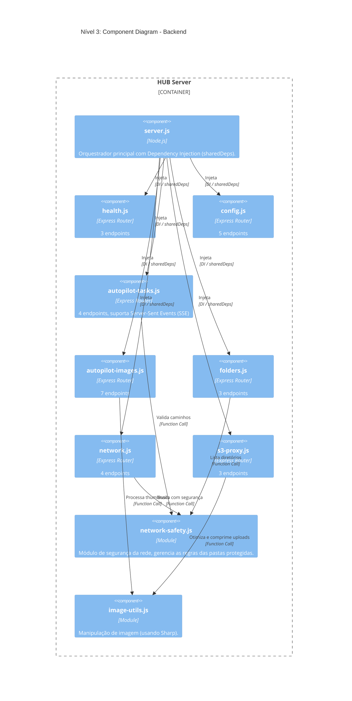
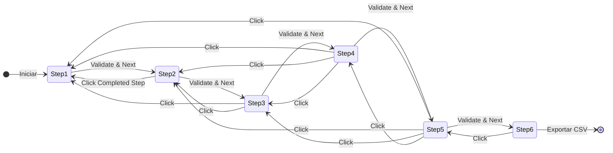
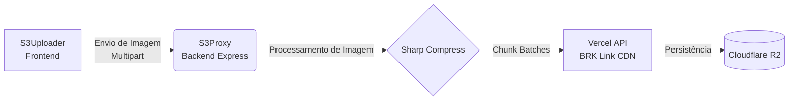
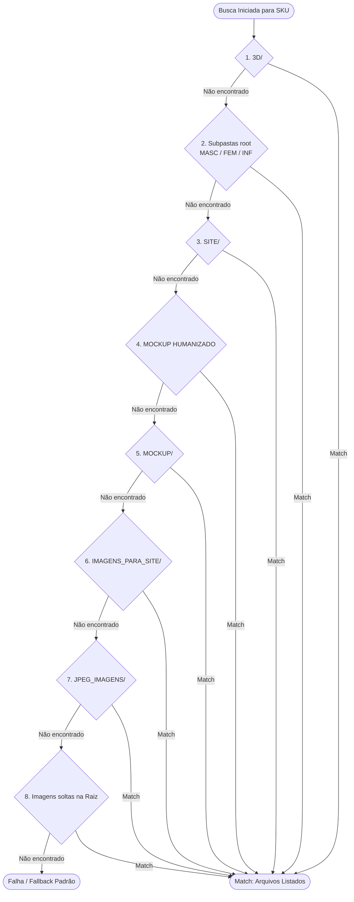

# Documentação de Arquitetura C4 - HOOK PRIME

Este documento descreve a arquitetura do **HOOK PRIME** utilizando o [Modelo C4](https://c4model.com/). Ele está dividido em quatro níveis, proporcionando uma visão técnica do sistema, desde o contexto de alto nível até os detalhes de fluxo de código.

---

## Nível 1: Contexto de Sistema (System Context)

O diagrama de contexto foca na visão geral do sistema, identificando os atores (usuários) e os sistemas externos com os quais o HOOK PRIME interage.



**Descrição:**
- **Operador BRK (Equipe de Cadastro):** É o usuário final principal que utiliza o portal rodando localmente (localhost:3000) para processar os produtos.
- **Admin (Gerente de Produto):** Configura regras de negócio e fluxos processuais.
- **HOOK PRIME:** O sistema core construído em Node.js e Express, que fornece a interface (SPA) e a API (HUB Server).
- Sistemas externos incluem o Servidor local para consumo de imagens de produtos, o Cloudflare R2 (BRK Link CDN) para armazenamento na nuvem e o Bling ERP para onde o CSV final será importado.

---

## Nível 2: Diagrama de Container

O diagrama de container divide o sistema HOOK PRIME em suas principais peças de execução, demonstrando como elas comunicam entre si.



**Descrição:**
O SPA em **Vanilla JS** roda diretamente no navegador, eliminando tempos de build e conectando-se ao **HUB Server**. O servidor delega as tarefas críticas de busca em rede para o **Network Safety Guard**, que aplica as restrições e segurança em 57 pastas designadas. Os metadados de configuração e uploads temporários ficam armazenados em pastas locais do backend.

---

## Nível 3: Diagrama de Componentes

### Backend (HUB Server)

Mostra a estrutura interna de componentes, injetados a partir do `server.js`.



**Descrição:**
A arquitetura do Express usa um padrão de **Injeção de Dependência** (`sharedDeps`) gerenciado pelo orquestrador `server.js`. Roteadores lidam com as responsabilidades específicas do sistema, e delegam complexidades para módulos de serviço internos como `network-safety.js` e `image-utils.js`.

### Frontend Autopilot (SPA)

Mostra a estrutura de componentes e gestão de estado no frontend.

```mermaid
C4Component
    title Nível 3: Component Diagram - Frontend Autopilot

    Container_Boundary(spa, "Browser SPA") {
        Component(autopilot, "autopilot.js", "Vanilla JS", "Orquestrador e inicializador principal.")
        
        Boundary(core, "Core (Lógica Base)") {
            Component(state, "state.js", "JS Object", "Armazena o estado global da sessão.")
            Component(helpers, "helpers.js", "Functions", "Utilitários DOM.")
            Component(codegen, "code-gen.js", "Functions", "Gera códigos e constrói o CSV.")
        }
        
        Component(uploader, "uploader.js", "Module", "Gerenciamento de fila de upload.")
        Component(steps, "steps (1 a 6)", "Modules", "Lógica de UI e validação de cada passo.")
        
        Boundary(products, "Products") {
            Component(apc, "apc.js", "Config", "Regras para produto APC.")
            Component(unique, "unique.js", "Config", "Regras para produto Unique.")
            Component(variation, "variation.js", "Config", "Regras para produto Variation.")
        }
        
        Boundary(data, "Data Layer") {
            Component(registry, "registry.js", "Store", "Registro persistente do produto.")
            Component(estampas, "estampas.js", "Store", "Catálogo de estampas mapeadas.")
        }

        Rel(autopilot, state, "Inicializa estado global", "Function")
        Rel(autopilot, steps, "Aciona carregamento", "Function")
        Rel(autopilot, uploader, "Registra callbacks", "Function")
        Rel(steps, products, "Lê regras de variação", "Function")
        Rel(steps, core, "Modifica estado / Usa Helpers", "Function")
        Rel(products, data, "Lê registros e estampas", "Function")
    }
```

**Descrição:**
O front-end não possui ferramentas complexas de build. O arquivo principal `autopilot.js` orquestra diferentes camadas lógicas, desde utilitários comuns no Core, fluxos fracionados nos Steps, até as regras específicas para cada tipo de produto na sub-camada Products.

---

## Nível 4: Code Diagram (Fluxos Específicos)

### Máquina de Estados: Autopilot Wizard

Representação da transição entre os passos do assistente de cadastro (Steps 1 a 6). A navegação regressiva é suportada ao se clicar em um passo já completado.



**Descrição:** 
Cada passo exige a validação de seus campos antes de prosseguir. O usuário pode retroceder a um passo prévio sem perder os dados armazenados em `state`.

### Pipeline de Upload

Diagrama do fluxo de dados para as imagens que vão até a CDN.



**Descrição:** 
O pipeline de upload fragmenta e delega o processamento da imagem em etapas. O S3Proxy no backend comprime o arquivo na hora usando Sharp, envia os chunks de dados em lotes (batches) para a API servida na Vercel, que por sua vez salva no bucket R2 da Cloudflare.

### Network Smart Scan

Lógica de cascata em 8 níveis realizada pelo `network-safety.js` para localizar dinamicamente a pasta certa da imagem, caso não esteja na raiz padrão.



**Descrição:**
Para evitar quebras quando as imagens do produto não seguem estritamente a padronização, a funcionalidade de *Smart Scan* vasculha a pasta da rede descendo uma árvore de regras de fallback com 8 níveis até achar os arquivos ou informar o erro ao sistema.
