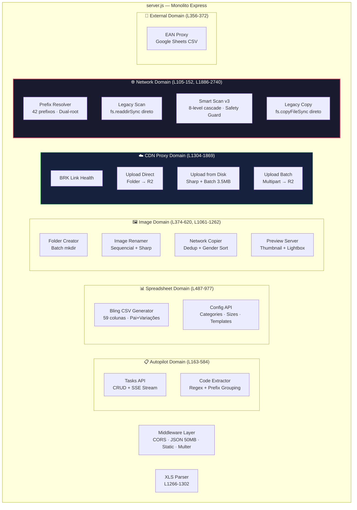
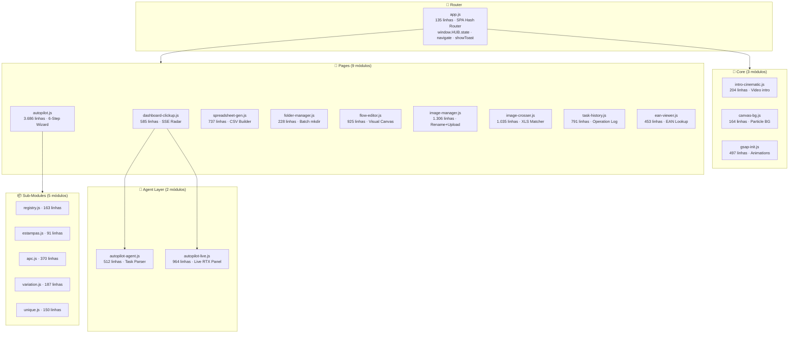

# C3 — Components

> **Nível C4:** Component | **Audiência:** Desenvolvedores e mantenedores

## Backend — server.js (2.767 linhas / 8 domínios implícitos)

## Frontend — 22 Módulos JS (13.098 linhas)

## Inventário Completo — Backend Endpoints (29)

| # | Método | Caminho | Domínio |
|---|--------|---------|---------|
| 1 | GET | `/api/health` | Core |
| 2 | GET | `/api/autopilot/stream` | Autopilot (SSE) |
| 3 | GET | `/api/autopilot/ping` | Autopilot |
| 4 | POST | `/api/autopilot/tasks` | Autopilot |
| 5 | PATCH | `/api/autopilot/tasks/:id/status` | Autopilot |
| 6 | DELETE | `/api/autopilot/tasks/:id` | Autopilot |
| 7 | GET | `/api/ean-proxy` | External |
| 8 | POST | `/api/folders/create` | Images |
| 9 | POST | `/api/images/rename` | Images |
| 10 | GET | `/api/config/categories` | Config |
| 11 | GET | `/api/config/sizes` | Config |
| 12 | GET | `/api/config/templates/:type` | Config |
| 13 | POST | `/api/autopilot/scan-folder` | Images |
| 14 | GET | `/api/preview-image` | Images |
| 15 | POST | `/api/autopilot/generate-apc-spreadsheet` | Spreadsheet |
| 16 | GET | `/api/autopilot/download-spreadsheet` | Spreadsheet |
| 17 | POST | `/api/scan-upload-folder` | Images |
| 18 | POST | `/api/autopilot/copy-network-images` | Network |
| 19 | GET | `/api/autopilot/images/:taskId/:code` | Images |
| 20 | GET | `/api/autopilot/images/:taskId/:code/*` | Images |
| 21 | POST | `/api/crosser/parse-xls` | Parser |
| 22 | GET | `/api/s3-proxy/health` | CDN |
| 23 | POST | `/api/s3-proxy/upload-from-folder-direct` | CDN |
| 24 | POST | `/api/s3-proxy/upload-from-disk` | CDN |
| 25 | POST | `/api/s3-proxy/upload-batch` | CDN |
| 26 | GET | `/api/network/config` | Network |
| 27 | POST | `/api/network/scan` | Network |
| 28 | POST | `/api/network/smart-scan` | Network |
| 29 | POST | `/api/network/copy` | Network |
