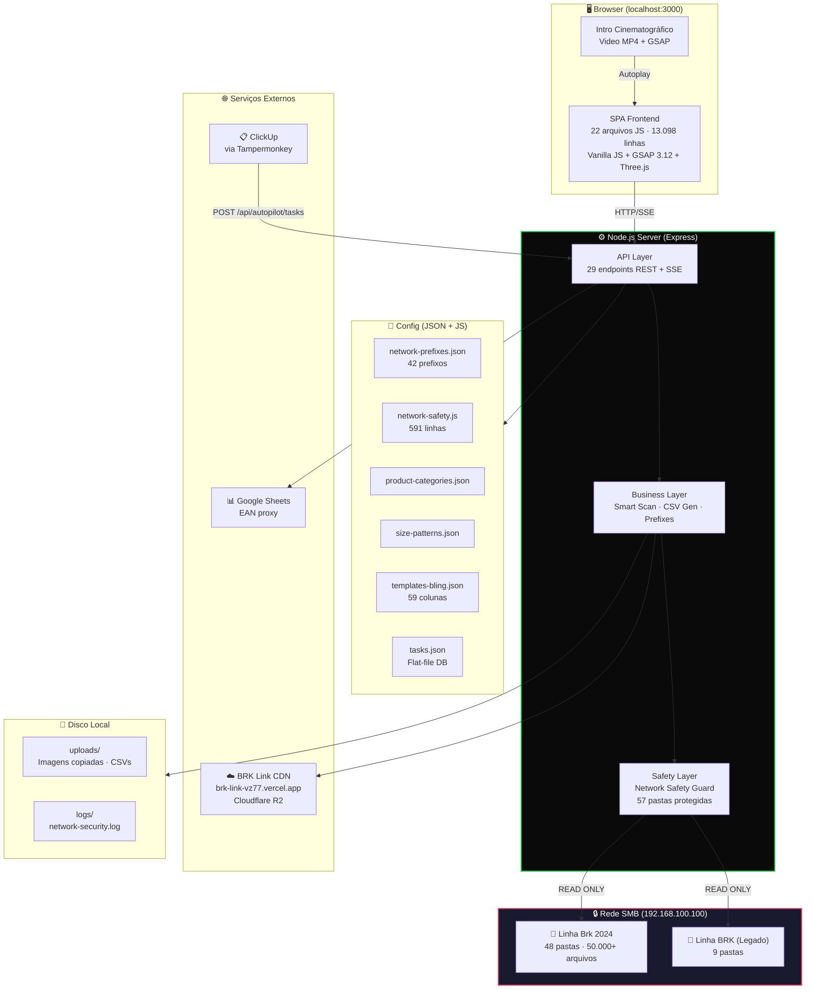

# C2 — Containers

> **Nível C4:** Container | **Audiência:** Desenvolvedores, operações, arquitetos

## Diagrama de Containers

## Inventário de Containers

| Container | Tecnologia | Linhas | Responsabilidade |
|-----------|-----------|--------|-----------------|
| **Frontend SPA** | Vanilla JS, GSAP, HTML/CSS | 13.098 JS + 2.285 CSS | UI, navegação, estado local, uploads |
| **Node.js Server** | Express 4.21 | 2.767 | API REST, SSE, integração rede/CDN |
| **Config Layer** | JSON + CommonJS | ~1.050 | Configuração declarativa |
| **Network SMB** | Windows SMB | — | Fonte de imagens de produto |
| **BRK Link CDN** | Vercel + Cloudflare R2 | — | Storage público de imagens |
| **Disco Local** | Filesystem | — | Staging de imagens e CSVs |

## Protocolos de Comunicação

| De → Para | Protocolo | Formato |
|-----------|-----------|---------|
| Browser → Server | HTTP REST | JSON |
| Server → Browser | SSE (Server-Sent Events) | `text/event-stream` |
| Server → Rede SMB | UNC Path (`\\\\`) | `fs.*` via Safety Guard |
| Server → CDN | HTTPS POST multipart | FormData → JSON URLs |
| ClickUp → Server | HTTP POST (Tampermonkey) | JSON |
| Server → Google Sheets | HTTPS GET (proxy) | CSV |
