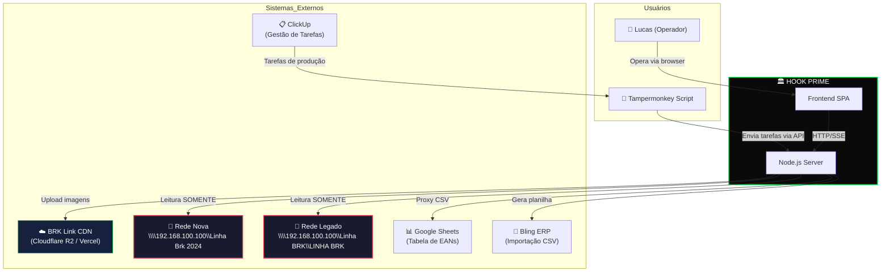

# C1 — System Context

> **Nível C4:** Context | **Audiência:** Todos (técnicos e não-técnicos)

## O que é o HOOK PRIME?

Sistema de automação enterprise para gestão de produtos e-commerce da marca **BRK**.
Automatiza o fluxo: scan de rede → classificação de gênero → cópia local → upload CDN → geração de planilha ERP.

## Diagrama de Contexto



## Atores

| Ator | Tipo | Interação |
|------|------|-----------|
| Lucas (Operador) | Humano | Opera o sistema via browser `localhost:3000` |
| Tampermonkey Script | Software | Injeta tarefas do ClickUp na API do servidor |
| ClickUp | SaaS externo | Fonte de tarefas de produção (códigos de produto) |
| BRK Link CDN | SaaS externo | Armazenamento de imagens (Cloudflare R2 via Vercel) |
| Rede Nova (192.168.100.100) | Infraestrutura interna | Pasta SMB com imagens de produtos atuais |
| Rede Legado (192.168.100.100) | Infraestrutura interna | Pasta SMB com imagens de produtos antigos |
| Google Sheets | SaaS externo | Tabela de EANs (códigos de barras) |
| Bling ERP | SaaS externo | Consome CSV gerado para cadastro de produtos |

## Fluxo Principal

```
ClickUp → Tampermonkey → API → Scan Rede → Cópia Local → Upload CDN → Planilha Bling
```
