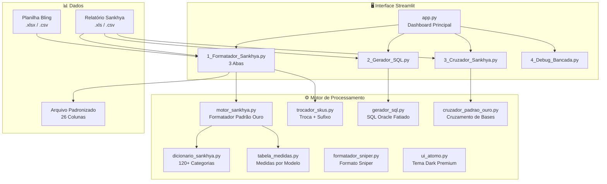

# Sankhya Data Suite — Documentação da Plataforma

> **Blue Liquid Edition** · Desenvolvido por Lucas Lima
> Plataforma de tratamento inteligente de dados para integração entre Bling e Sankhya ERP

---

## 1. O Que É

O **Sankhya Data Suite** é uma plataforma web interna construída em Python/Streamlit que automatiza o processo de tratamento, padronização e sincronização de dados de produtos entre o sistema de e-commerce **Bling** e o ERP **Sankhya**.

A plataforma transforma planilhas brutas exportadas do Bling — com formatos inconsistentes, colunas variáveis e dados sujos — em arquivos padronizados prontos para importação no Sankhya, seguindo o **Padrão Ouro de 26 colunas**.

---

## 2. Qual Dor Resolve

### Antes da plataforma (processo manual):

| Problema | Impacto |
|---|---|
| Planilhas do Bling vinham em formatos diferentes a cada exportação | Horas de retrabalho para padronizar |
| O ERP Sankhya exige exatamente 26 colunas com nomes e formatos específicos | Erros de importação, rejeições, produtos cadastrados errados |
| EANs/Códigos de barras corrompidos por notação científica do Excel (ex: `7.89172E+12`) | Produtos sem código de barras no Sankhya → falha no checkout |
| Classificação manual de centenas de produtos em grupos/categorias (CODGRUPOPROD) | Erro humano na classificação → relatórios fiscais incorretos |
| SKUs diferentes entre Bling e Sankhya (bases desconectadas) | Impossível cruzar inventário, duplicações de cadastro |
| Conflito de cadastro no Bling ao reimportar produtos atualizados | Travamento do fluxo de trabalho, retrabalho |
| Gerar SQL manualmente para consultar produtos no Sankhya (limite de 1000 itens Oracle) | Processo demorado e propenso a erro |
| Sem visibilidade de quais produtos já existem no Sankhya e quais são novos | Duplicações, cadastros perdidos |

### Com a plataforma:

> [!TIP]
> **Tempo economizado:** O que levava **4-6 horas** de trabalho manual por coleção agora leva **menos de 5 minutos** — upload, processar, download.

- ✅ **Formatação automática** de qualquer planilha Bling para as 26 colunas do Sankhya
- ✅ **EANs blindados** — correção automática de notação científica, zeros à esquerda, validação de 8-14 dígitos
- ✅ **Classificação inteligente** — dicionário com 120+ categorias mapeia automaticamente o CODGRUPOPROD
- ✅ **Troca de SKUs em lote** — substituição automática de SKUs Bling por CODPRODs Sankhya
- ✅ **Sufixo anti-conflito** — adiciona `_S` nos códigos pai para evitar colisão no Bling
- ✅ **SQL seguro e fatiado** — gera queries Oracle dentro do limite de 900 itens/lote
- ✅ **Cruzamento de bases** — identifica novos produtos vs. existentes no Sankhya

---

## 3. Arquitetura da Plataforma



---

## 4. Módulos e Funcionalidades

### 4.1 🏅 Formatador Padrão Ouro (Aba 1)

> **Página:** `1_Formatador_Sankhya.py` → Aba "Formatador Padrão Ouro"
> **Motor:** `core/motor_sankhya.py` + `core/dicionario_sankhya.py`

#### O que faz
Transforma qualquer planilha do Bling (ou similar) no layout exato de **26 colunas** que o ERP Sankhya exige para importação de produtos.

#### Entrada
- Planilha do Bling (.xlsx, .xls, .csv) com estrutura Pai/Filho (variações de tamanho)

#### Saída
- Arquivo CSV (encoding cp1252) ou Excel com exatamente 26 colunas no Padrão Ouro

#### As 26 Colunas do Padrão Ouro

| # | Coluna | Descrição | Exemplo |
|---|---|---|---|
| 1 | `AD_IDEXTERNO` | ID externo (vazio) | |
| 2 | `CODGRUPOPROD` | Código do grupo de produto | `020101` |
| 3 | `CODVOL` | Unidade de venda | `UN` |
| 4 | `DESCRPROD` | Descrição completa (SKU + Nome + Tamanho) | `RAGLAN269PP - CAMISA UV50 BRK...` |
| 5 | `TEMIPICOMPRA` | Tem IPI compra | `N` |
| 6 | `TEMIPIVENDA` | Tem IPI venda | `N` |
| 7 | `UNIDADE` | Unidade de medida | `CM` |
| 8 | `USACODBARRASQTD` | Usa código de barras por quantidade | `N` |
| 9 | `USOPROD` | Uso do produto (V=Venda, R=Revenda) | `V` |
| 10 | `MARCA` | Marca | `BRK` |
| 11 | `NCM` | Nomenclatura Comum do Mercosul | `6101.30.00` |
| 12 | `REFERENCIA` | Código EAN/GTIN | `7891715844552` |
| 13 | `REFFORN` | Referência do fornecedor | |
| 14 | `CODPROD` | Código do produto (vazio, gerado pelo Sankhya) | |
| 15 | `PESOBRUTO` | Peso bruto (kg) | `0,25` |
| 16 | `PESOLIQ` | Peso líquido (kg) | `0,25` |
| 17 | `TEMICMS` | Tem ICMS | `S` |
| 18 | `AD_IDEXTERNO2` | SKU externo (código Bling) | `RAGLAN269PP` |
| 19 | `ALTURA` | Altura (cm) | `4` |
| 20 | `AD_TAMTECIDO` | Tamanho do tecido | |
| 21 | `CODVOLCOMPRA` | Unidade de compra | `UN` |
| 22 | `CSTIPIENT` | CST IPI entrada | `99` |
| 23 | `CSTIPISAI` | CST IPI saída | `-1` |
| 24 | `LARGURA` | Largura (cm) | `22` |
| 25 | `ORIGPROD` | Origem do produto | `0` |
| 26 | `DECVLR` | Decimais no valor | `2` |
| — | `DECQTD` | Decimais na quantidade | `2` |

#### Dois Modos de Processamento

| Modo | Quando Usar | Comportamento |
|---|---|---|
| **MODO A — Produto Único** | Iscas, equipamentos, acessórios (sem variação de tamanho) | Cada linha = 1 produto final |
| **MODO B — Produto com Variação** | Camisas, vestuário (com grades PP→G2) | Linhas Pai são descartadas, apenas filhos (com EAN) viram produtos |

#### Regras de Negócio Críticas

**Classificação Automática (CODGRUPOPROD):**
O dicionário com 120+ entradas classifica automaticamente cada produto na hierarquia correta:

| Grupo | Código | Exemplo |
|---|---|---|
| Revenda | `0101xx` | Geladeira, Isca Artificial, Vara de Pesca |
| Produção Masculino | `0201xx` | Camisa Master, FusionX, Hybrid, Raglan |
| Produção Feminino | `0205xx` | Camisa Fem Master, Raglan Feminino |
| Produção Infantil | `0206xx` | Camisa Infantil |
| Envio Imediato | `1201xx` | Camisa Manga Longa, Hybrid, Tubeneck |
| Acessórios | `0202xx` | Bandana, Tubeneck, Black Mask |

**Regra Raglan (Interceptador Prioritário):**

| Tipo | Código | Detecção |
|---|---|---|
| Raglan Masculino | `20113` | SKU começa com `RAGLAN` (sem BL) |
| Raglan Feminino | `20513` | SKU começa com `RAGLAN` e contém `BL` |
| Raglan Infantil | `20613` | SKU começa com `RAGLAN` e contém `I` |

**Proteção de EAN:**
- Corrige notação científica do Excel (`7.89172E+12` → `7891715844552`)
- Preserva zeros à esquerda
- Valida formato (8-14 dígitos)
- EAN-12 → preenchimento automático para EAN-13

**Correção de SKU:**
- `RAGALN` → `RAGLAN` (typo corrigido automaticamente)

**Ajuste de Gênero Automático:**
Se a categoria ou título indica feminino/infantil, o código masculino é ajustado automaticamente:
- `020100` (Masc) → `020500` (Fem) se detectar BL, FEMININA, FEM
- `020100` (Masc) → `020600` (Inf) se detectar INFANTIL, INFAN

---

### 4.2 🔀 Trocador de SKUs (Aba 2)

> **Página:** `1_Formatador_Sankhya.py` → Aba "Troca de SKUs Bling"
> **Motor:** `core/trocador_skus.py`

#### O que faz
Substitui os SKUs da planilha do Bling (ex: `RAGLAN269PP`) pelos **CODPRODs do Sankhya** (ex: `74897`), usando um relatório de/para do Sankhya.

#### Entrada
1. **Planilha Bling** (.xlsx, .csv) — a planilha original com SKUs Bling
2. **Relatório Sankhya** (.xls) — com colunas `Código` (CODPROD) e `Cód. Sistema Anterior 2` (SKU Bling)

#### Saída
- Planilha Bling com SKUs trocados, preservando 100% do formato original (EANs, colunas, estrutura)

#### Funcionalidades

| Feature | Descrição |
|---|---|
| **Leitor Inteligente** | Detecta automaticamente o cabeçalho real do relatório Sankhya (pula linhas de metadata) |
| **Auto-Detecção de Colunas** | Identifica `Cód. Sistema Anterior 2` e `Código` sem intervenção manual |
| **Preview do Mapa** | Mostra as primeiras 15 trocas antes de processar |
| **Preservação Total** | Não altera nenhuma outra coluna — apenas `Código` e `Código Pai` |
| **Separação Pai/Filho** | SKUs pai sem match são reportados como "cabeçalhos virtuais" (informativo, não erro) |

---

### 4.3 🏷️ Sufixo _S nos Pais (Aba 3)

> **Página:** `1_Formatador_Sankhya.py` → Aba "Sufixo _S nos Pais"
> **Motor:** `core/trocador_skus.py` → `adicionar_sufixo_pai()`

#### O que faz
Adiciona o sufixo `_S` a todos os códigos de **produtos pai** na planilha do Bling para evitar conflito de cadastro na reimportação.

#### Por que é necessário
No Bling, quando se reimporta uma coleção atualizada, os códigos pai podem colidir com produtos já existentes. O sufixo `_S` diferencia a nova versão do cadastro.

#### Comportamento

| Item | Antes | Depois |
|---|---|---|
| Código do Pai | `C02727` | `C02727_S` |
| Código Pai nos Filhos | `C02727` | `C02727_S` |
| Código dos Filhos (variações) | `69167` | `69167` (NÃO MUDA) |
| EANs | `7891716476653` | `7891716476653` (NÃO MUDA) |

#### Características
- Sufixo customizável (padrão: `_S`)
- Não duplica se já tiver o sufixo
- Processo independente do Sankhya
- Preview visual antes de aplicar

---

### 4.4 🔗 Gerador SQL

> **Página:** `2_Gerador_SQL.py`
> **Motor:** `core/gerador_sql.py`

#### O que faz
Extrai SKUs e EANs de uma planilha e gera queries SQL Oracle prontas para consultar esses produtos no banco do Sankhya (DbExplorer).

#### Problema que resolve
O DbExplorer do Sankhya tem limite de ~1000 itens por consulta `IN(...)`. O gerador fatia automaticamente em **lotes de 900 itens**.

#### Saída
```sql
SELECT * FROM TGFPRO WHERE AD_IDEXTERNO2 IN ('RAGLAN269PP','RAGLAN269P',...) 
   OR REFERENCIA IN ('7891715844552','7891715845924',...)
```

- Queries paginadas e numeradas
- Botão de cópia rápida
- Formato seguro para Oracle

---

### 4.5 🔀 Cruzador de Dados

> **Página:** `3_Cruzador_Sankhya.py`
> **Motor:** `core/cruzador_padrao_ouro.py`

#### O que faz
Cruza uma planilha formatada (Padrão Ouro) com um relatório real do Sankhya para identificar:

| Resultado | Significado |
|---|---|
| **Produtos Novos** | Existem na planilha mas NÃO no Sankhya → precisam ser cadastrados |
| **Produtos Existentes** | Já estão no Sankhya → podem ser atualizados ou ignorados |
| **Divergências** | Dados diferentes entre planilha e Sankhya (descrição, NCM, grupo) |

#### Saída
- Relatório visual com estatísticas
- Arquivo Excel filtrado com apenas os produtos novos (prontos para importação)

---

### 4.6 🔬 Debug Bancada

> **Página:** `4_Debug_Bancada.py`

#### O que faz
Modo diagnóstico visual "raio-X" para qualquer arquivo — mostra exatamente o que o Python lê, incluindo:
- Encoding detectado
- Separador detectado
- Colunas encontradas
- Primeiras linhas do arquivo
- Tipos de dados

Usado para investigar problemas de importação, encodings quebrados ou estruturas inesperadas.

---

## 5. Stack Tecnológico

| Componente | Tecnologia | Versão |
|---|---|---|
| **Linguagem** | Python | 3.14 |
| **Framework Web** | Streamlit | 1.56.0 |
| **Processamento** | Pandas | 3.0.2 |
| **Excel XLSX** | openpyxl | 3.1.5 |
| **Excel XLS** | xlrd | 2.0.2 |
| **Excel Export** | xlsxwriter | — |
| **Performance** | PyArrow | 24.0.0 |
| **Deploy** | Streamlit Cloud | via GitHub |
| **Versionamento** | Git + GitHub Desktop | — |
| **Tema Visual** | Custom CSS (Blue Liquid Dark) | — |

---

## 6. Fluxo Operacional Completo

```mermaid
flowchart TD
    A["📥 Exportar planilha do Bling<br/>(COLEÇÃO MOTO CUSTOM.xlsx)"] --> B

    B["🏅 Formatador Padrão Ouro<br/>Aba 1: Formata para 26 colunas"] --> C

    C{"Precisa trocar<br/>SKUs?"}
    C -->|Sim| D["🔀 Trocador de SKUs<br/>Aba 2: Bling SKU → Sankhya CODPROD"]
    C -->|Não| E

    D --> E{"Precisa sufixo<br/>anti-conflito?"}
    E -->|Sim| F["🏷️ Sufixo _S<br/>Aba 3: Adiciona _S nos pais"]
    E -->|Não| G

    F --> G["🔗 Gerador SQL<br/>Gera queries para o DbExplorer"]

    G --> H["🔍 Consulta no Sankhya<br/>Via DbExplorer"]

    H --> I["🔀 Cruzador de Dados<br/>Identifica novos vs. existentes"]

    I --> J["📤 Importação no Sankhya<br/>Apenas produtos novos"]

    style A fill:#1a1a2e,stroke:#2979ff
    style B fill:#1a1a2e,stroke:#64b5f6
    style D fill:#1a1a2e,stroke:#64b5f6
    style F fill:#1a1a2e,stroke:#64b5f6
    style G fill:#1a1a2e,stroke:#64b5f6
    style I fill:#1a1a2e,stroke:#64b5f6
    style J fill:#1a1a2e,stroke:#2979ff
```



---

## 7. Deploy e Acesso

| Item | Valor |
|---|---|
| **Repositório** | `github.com/pensador999/PYTHON-DATA` (privado) |
| **Branch** | `main` |
| **Hosting** | Streamlit Community Cloud |
| **Deploy** | Automático via push no GitHub |
| **Tema** | Blue Liquid Dark (custom CSS) |

---

## 8. Resumo Executivo

O **Sankhya Data Suite** é uma plataforma interna que automatiza todo o fluxo de tratamento de dados de produtos entre Bling e Sankhya ERP. Em vez de gastar horas formatando planilhas manualmente, classificando produtos e gerando consultas SQL, o operador faz um upload e recebe o arquivo pronto em segundos.

A plataforma resolve as seguintes dores críticas:

1. **Padronização** — converte qualquer planilha no formato exato do Sankhya (26 colunas)
2. **Classificação** — mapeia automaticamente 120+ categorias de produtos
3. **Integridade** — protege EANs contra corrupção do Excel
4. **Sincronização** — troca SKUs entre bases Bling/Sankhya automaticamente
5. **Anti-conflito** — adiciona sufixos para evitar colisão de cadastro
6. **Consulta** — gera SQL fatiado para o limite Oracle do DbExplorer
7. **Auditoria** — cruza dados para identificar novos cadastros vs. existentes

> **Desenvolvido por Lucas Lima** · Sankhya Data Suite · Blue Liquid Edition
